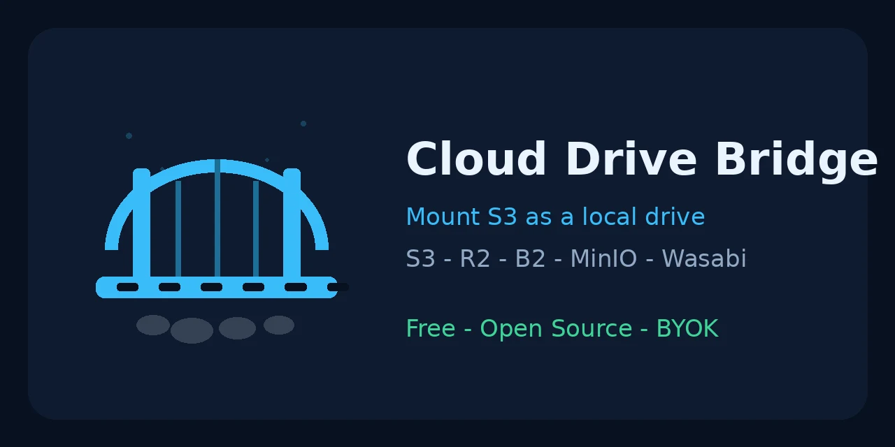

# Cloud Drive Bridge — Mount S3 as a Drive | Free S3 Drive Mounter for Cloudflare R2, Backblaze B2, MinIO & Wasabi 🌉



[](LICENSE)
[](#-download)
[](#)
[](#-security--byok-done-right)

**Cloud Drive Bridge is a free, open-source S3 drive mounter** ✨ — connect **any S3-compatible bucket** and use it like a local drive:

- 🌉 **Mount Amazon S3, Cloudflare R2, Backblaze B2, MinIO, Wasabi** (+ Spaces, Linode, Oracle, IBM COS, Ceph, custom endpoints) as a **drive letter on Windows** or a folder on macOS/Linux
- 📂 **Browse, upload, download, delete, rename** — with checksum-verified uploads
- 🔑 **BYOK done right:** your keys live in your **OS keychain only** — never in a config file, never logged (rclone gets them via environment variables only)
- 🛡️ **Mount watchdog** — auto-remounts with backoff when a mount drops (the fix for rclone's flaky reconnects)
- 🔗 **Share links** with 1h / 24h / 7d expiry, 📌 **offline pins**, ⚡ a researched performance mount profile
- 🆓 **The free Mountain Duck / RaiDrive / ExpanDrive alternative** — and a friendly **rclone GUI** for people who don't want the command line

> Built for makers, homelabbers, founders and teams who keep real work in cheap object storage and are tired of syncing whole buckets or paying $39–$99/year just to see them as a drive. **Use buckets you own or are authorized to access.**

---

## ✨ Features

| | |
|---|---|
| 🌉 Drive mount | rclone mount with performance profile: VFS cache `full`, 128M buffers/chunks, 4 transfers, 8 checkers, 12h dir-cache (1000h offline mode), 5G cache cap, optional bandwidth limit + read-only |
| 🛡️ Watchdog + auto-mount | Health check every few seconds, auto-remount with 5s→60s backoff; auto-mount on login (Windows Run / macOS LaunchAgent / Linux systemd user unit) |
| 🔑 11 provider presets | AWS S3 · Cloudflare R2 · Backblaze B2 · MinIO · Wasabi · DigitalOcean Spaces · Linode · Oracle · IBM COS · Ceph · Custom |
| 🧪 5-point check | Reachability / auth / list / write / delete — with a probe file that cleans itself up |
| 📂 Pro browser | Instant filter, sort by name/size/date, folder navigation, create-folder, rename, bucket usage stats, storage class |
| ✅ Verified uploads | ETag vs MD5 comparison for single-part uploads; multipart ETags honestly reported as *not* a plain MD5 |
| 🔗 Share links | Presigned URLs (1h / 24h / 7d), expiry always shown |
| 📌 Offline pin | Pin files/folders into the VFS cache so they open instantly and survive short offline periods |
| 🔁 Transfer engine | Folder copy/sync via rclone with retries + backoff, pause/resume (Unix), cancel |
| 🌐 WebDAV fallback | No WinFsp? `rclone serve webdav` on localhost + `net use` — no driver needed |
| 💻 CLI included | `cdb test · ls · get · put · rm · mkdir · rename · size · share · mount` |

## 🖥️ Platforms — honest status

| Platform | Status | How |
|---|---|---|
| Windows | ✅ Shipped in v0.1 | WinFsp + rclone → drive letter; WebDAV fallback without it |
| macOS | ✅ Shipped in v0.1 | macFUSE (FSKit backend requested on macOS 15.4+ / macFUSE 5; classic backend + one-time approval on older setups) |
| Linux / Debian | ✅ Shipped in v0.1 | FUSE3 native — best-supported platform |
| Android | ✅ Shipped in v0.1 | Browse + transfer app. **No mount** — see below |
| iOS | 🔜 Roadmap v0.3 | File Provider extension (needs Apple signing decision) |
| Android true mount | ❌ Not possible without root | We will never fake it |

Full architecture + v0.2/v0.3 plan: **[ROADMAP.md](ROADMAP.md)** — including the Android SAF DocumentsProvider that will put buckets in *every* app's file picker (RSAF-proven), rclone crypt vaults, version restore, and two-way sync.

## ⚖️ Cloud Drive Bridge vs the alternatives

| | Cloud Drive Bridge | Mountain Duck / RaiDrive / ExpanDrive | rclone CLI |
|---|---|---|---|
| Price | **Free forever (MIT)** | $39–$99 / year or license | Free |
| GUI | ✅ King-simple, 3 screens | ✅ | ❌ command line only |
| Source code | ✅ open | ❌ closed | ✅ open |
| Keys storage | **OS keychain; rclone via env only** | App config | Plain-text config file |
| Watchdog auto-remount | ✅ | ❌ | ❌ (manual remount) |
| Windows no-driver fallback | ✅ WebDAV mode | ❌ | ❌ |
| Android app | ✅ browse + transfer | ❌ | ⚠️ terminal only |

## 📥 Download

Grab the latest release for your platform:

| Platform | File |
|---|---|
| Windows | `Cloud.Drive.Bridge_0.1.0_x64-setup.exe` or `.msi` |
| macOS (Apple Silicon) | `Cloud.Drive.Bridge_0.1.0_aarch64.dmg` |
| macOS (Intel) | `Cloud.Drive.Bridge_0.1.0_x64.dmg` |
| Linux | `Cloud.Drive.Bridge_0.1.0_amd64.AppImage` or `.deb` (Debian/Ubuntu) |
| Android | `cloud-drive-bridge-android.apk` (CI-signed, sideload) |
| CLI only | `cdb-windows-x64.exe` · `cdb-macos-arm64` · `cdb-linux-x64` |
| Docker | `docker build -t cloud-drive-bridge .` |

Prerequisites for mounting: **rclone** (free, rclone.org/downloads) + your platform driver — **WinFsp** (Windows), **macFUSE** (macOS), **fuse3** (Linux). The app detects both and tells you exactly what to install if they're missing. Browsing and transfers need only **curl** (built into Windows 10+, macOS and Linux).

iOS is planned (companion/File Provider mode), not yet released — we only list platforms you can actually download.

## 🚀 Quick start

1. Install the app, rclone, and your platform driver (above).
2. **Profiles** → add your bucket: provider, bucket name, region, endpoint, *your* access keys → **Save** (keys go to the keychain).
3. **Test** — run the 5-point check (add the write probe if it's your bucket).
4. **Mount** → pick a drive letter / folder → **🌉 MOUNT AS DRIVE**. Done — your bucket is a drive.
5. Or stay in **Browser** to move files, copy a 🔗 share link, or 📌 pin a folder offline.

## 💻 CLI usage

```bash
export CDB_ACCESS_KEY_ID=…        # your own keys — or use --from-keychain
export CDB_SECRET_ACCESS_KEY=…

cdb providers
cdb test  --bucket my-bucket --provider r2 --endpoint https://<acct>.r2.cloudflarestorage.com --probe
cdb ls    --bucket my-bucket --provider aws --region eu-west-1  photos/
cdb put   ./report.pdf reports/report.pdf --bucket my-bucket --provider aws
cdb share reports/report.pdf 24h  --bucket my-bucket --provider aws
cdb mount S: --bucket my-bucket --provider aws --cache 10G --offline
```

## 🔒 Security — BYOK done right

- **Your keys, your machine.** Secrets are stored in the OS keychain (Windows Credential Manager / macOS Keychain / Linux key store). On mobile v0.1 they are kept **in memory only**.
- **No credential files, ever.** rclone is configured exclusively through `RCLONE_CONFIG_<NAME>_*` environment variables; S3 calls go through system `curl --aws-sigv4`. Nothing secret is written to disk or logged — the `Secrets` type can't even print itself.
- **Least privilege:** create a bucket-scoped IAM key for this app. The 5-point write probe is opt-in and deletes its probe file.
- Rebuilt from the author's original Python script with a full pre-publish credential sweep (zero hits).

## 🏗️ How it works

```
Profile (bucket + endpoint) ─► keys from OS keychain
        │
        ├─► Browse/transfer: cdb-core ─► curl --aws-sigv4 ─► S3 API (ListObjectsV2 XML parsed in Rust)
        │
        └─► Mount: rclone mount (env-only config) ─► WinFsp / macFUSE / FUSE3 ─► drive letter / folder
                    ▲ watchdog: health check ─► auto-remount with backoff
                    ▲ auto-mount: Windows Run · macOS LaunchAgent · Linux systemd user unit
```

## 🙏 Thanks

rclone, WinFsp, macFUSE, FUSE, curl, Tauri, Rust — plus RSAF, CloudMount, fskit-s3, Mountit, mountpoint-s3, goofys and s3fs-fuse as research precedents. Full credits: **[THANKS.md](THANKS.md)**.

## 📄 License

MIT — free for everyone, forever. Built by [Shawon / Cyberspace Work](https://github.com/shawonlilo) as part of the OpenTools suite (Network Diagnostics · CleanReach · Cloud Drive Bridge · Opt-in Messaging).

<sub>Keywords: mount S3 as drive · S3 drive mounter · cloud drive bridge · mount Cloudflare R2 as drive · Backblaze B2 drive · MinIO mount · Wasabi drive · free Mountain Duck alternative · RaiDrive alternative · ExpanDrive alternative · rclone GUI · S3 browser · mount object storage Windows macOS Linux Android</sub>
